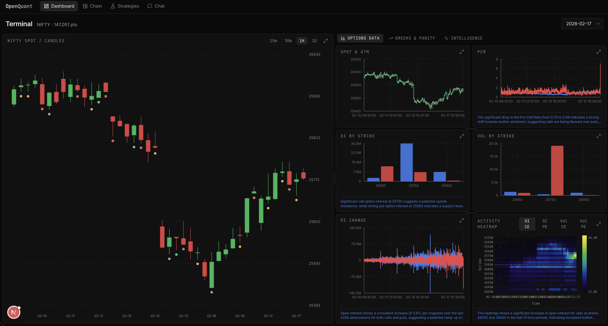
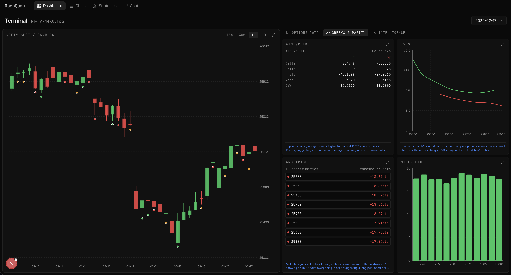
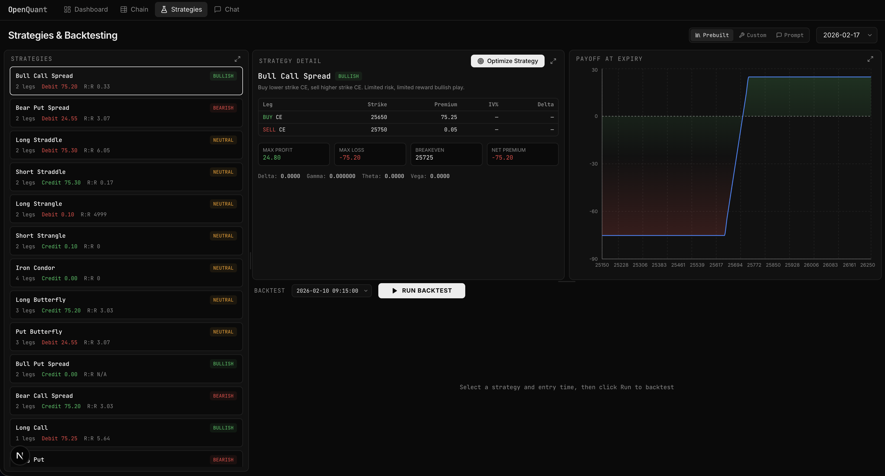
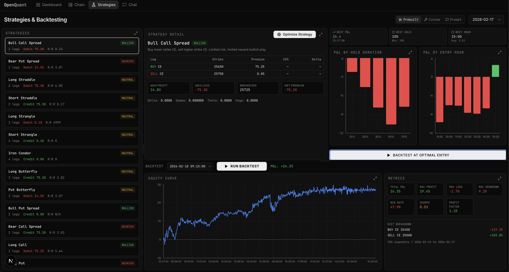

# OpenQuant

> **1st Place Winner - FOSS Club MPSTME CodeForge 2026**

OpenQuant is a full-stack options analytics platform for exploring NIFTY derivatives data with interactive visualizations, Greeks, volatility analysis, anomaly detection, strategy design, backtesting, and AI-assisted insights.

It combines a **FastAPI + Python analytics backend** with a **Next.js 15 + React 19 frontend**, using **Redis** for caching and **OpenRouter** for LLM-powered summaries and strategy recommendations.

## Screenshots

### Dashboard




### Strategies




## Highlights

- **Interactive analytics dashboard** for open interest, volume, PCR, spot, straddle price, OI change, candlestick patterns, and strike activity heatmaps.
- **Options Greeks engine** with implied volatility, Delta, Gamma, Theta, Vega, parity checks, mispricing detection, and IV surface views.
- **Option chain terminal** with CE/PE side-by-side metrics around ATM strikes.
- **ML-powered anomaly detection** using normalized snapshot features and `IsolationForest`.
- **Strategy lab** with prebuilt strategies, custom leg builder, payoff visualization, historical backtesting, and optimization.
- **AI features** for concise dashboard inferences and prompt-based strategy recommendations.
- **Portable deployment** through Docker Compose.

## App Sections

### 1. Dashboard

The main dashboard includes:

- Open interest by strike
- Volume by strike
- Put-call ratio time series
- Spot price and ATM tracking
- Straddle price evolution
- OI change over time
- Candlestick patterns
- Activity heatmap
- ML anomaly timeline and anomaly list
- AI-generated panel inferences

### 2. Option Chain

The chain view provides:

- Live chain snapshot for a selected expiry
- CE/PE OI, volume, LTP, IV, Delta, Gamma, Theta, Vega
- ATM-centered filtering
- IV smile chart
- Volatility surface visualization

### 3. Strategies

The strategies workspace supports:

- Prebuilt options strategies
- Strategy explanation and payoff breakdown
- Custom multi-leg strategy builder
- Historical backtesting
- Strategy optimization by entry time and hold duration
- Prompt-to-strategy recommendations via AI

### 4. Chat

The chat interface lets users ask natural-language questions about options data and receive concise answers with chart-capable tool responses.

## Architecture

### Frontend

- **Next.js 15** with App Router
- **React 19**
- **Tailwind CSS v4**
- **Recharts** for data visualization
- **react-resizable-panels** for terminal-style layouts
- **Vercel AI SDK + OpenRouter** for AI workflows

### Backend

- **FastAPI** API server
- **Pandas / NumPy / SciPy** for analytics and derivatives calculations
- **Scikit-learn** for anomaly detection and ML signals
- **SQLite** as the local analytical store
- **Redis** for caching ML-heavy responses

## Backend API Coverage

The backend exposes endpoints for:

- Dataset overview and metadata
- OI / volume aggregation by strike
- PCR, spot, max pain, straddle, and OI change time series
- Candle generation and pattern extraction
- Anomaly detection
- Greeks and implied volatility
- Option chain and IV surface
- Put-call parity arbitrage checks
- Activity heatmaps
- Strategy generation, payoff, backtesting, and optimization

## Data Pipeline

CSV files in `backend/data/` are migrated into `backend/data/options.db` through `backend/migrate_to_sqlite.py`.

During container builds, the backend automatically creates the SQLite database if CSV files are present and the database does not already exist.

Expected data fields include values such as:

- `datetime`
- `expiry`
- `strike`
- `spot_close`
- `oi_CE` / `oi_PE`
- `volume_CE` / `volume_PE`
- `CE` / `PE`
- `ATM`

## Repository Structure

```text
CodeForge/
├── assets/                    # README screenshots
├── backend/
│   ├── main.py                # FastAPI app and API endpoints
│   ├── greeks.py              # Black-Scholes, IV, Greeks
│   ├── ml_models.py           # Anomaly detection / ML helpers
│   ├── strategies.py          # Strategy generation and payoffs
│   ├── backtester.py          # Historical backtesting and optimization
│   ├── migrate_to_sqlite.py   # CSV -> SQLite migration
│   ├── requirements.txt       # Python dependencies
│   ├── Dockerfile             # Backend image
│   └── data/                  # CSV inputs and SQLite DB
├── frontend/
│   ├── src/app/               # Dashboard, chain, strategies, chat pages
│   ├── src/components/        # Charts, panels, navigation, heatmaps
│   ├── src/hooks/             # Frontend hooks
│   ├── src/lib/               # API helpers
│   ├── package.json           # Frontend dependencies
│   └── Dockerfile             # Frontend image
├── docker-compose.yml         # Full-stack local deployment
└── README.md
```

## Getting Started

### Prerequisites

- Docker and Docker Compose, **or**
- Python 3.12+, Node.js 20+, `pnpm`, and Redis

## Option A - Run with Docker Compose

From the project root:

```bash
docker compose up --build
```

Services:

- Frontend: `http://localhost:3000`
- Backend: `http://localhost:8000`
- API docs: `http://localhost:8000/docs`
- Redis: `localhost:6379`

## Option B - Run Locally

### 1. Backend

```bash
cd backend
python -m venv .venv
source .venv/bin/activate
pip install -r requirements.txt
python migrate_to_sqlite.py
uvicorn main:app --reload --port 8000
```

If you prefer `fastapi dev`, that works as well once dependencies are installed.

### 2. Redis

Start a local Redis instance on port `6379`.

### 3. Frontend

```bash
cd frontend
pnpm install
pnpm dev
```

Frontend runs on `http://localhost:3000`.

## Environment Variables

### Frontend

Create `frontend/.env.local` as needed:

```env
NEXT_PUBLIC_API_URL=http://localhost:8000
OPENROUTER_API_KEY=your_key_here
```

### Backend

The backend reads environment variables such as:

```env
REDIS_HOST=localhost
REDIS_PORT=6379
```

## Core Dependencies

### Backend

- `fastapi`
- `uvicorn`
- `pandas`
- `numpy`
- `scipy`
- `scikit-learn`
- `redis`
- `python-dotenv`

### Frontend

- `next`
- `react`
- `recharts`
- `@ai-sdk/react`
- `@openrouter/ai-sdk-provider`
- `lucide-react`
- `react-resizable-panels`

## Why This Project Won

OpenQuant was built to turn dense options data into a usable decision-support system:

- clear and information-dense UI
- real quantitative analytics
- ML anomaly detection
- practical options strategy workflows
- AI-assisted interpretation
- fully open-source stack end to end

## License

This repository is currently provided without an explicit license. Add one if you plan to distribute or open-source it publicly.
